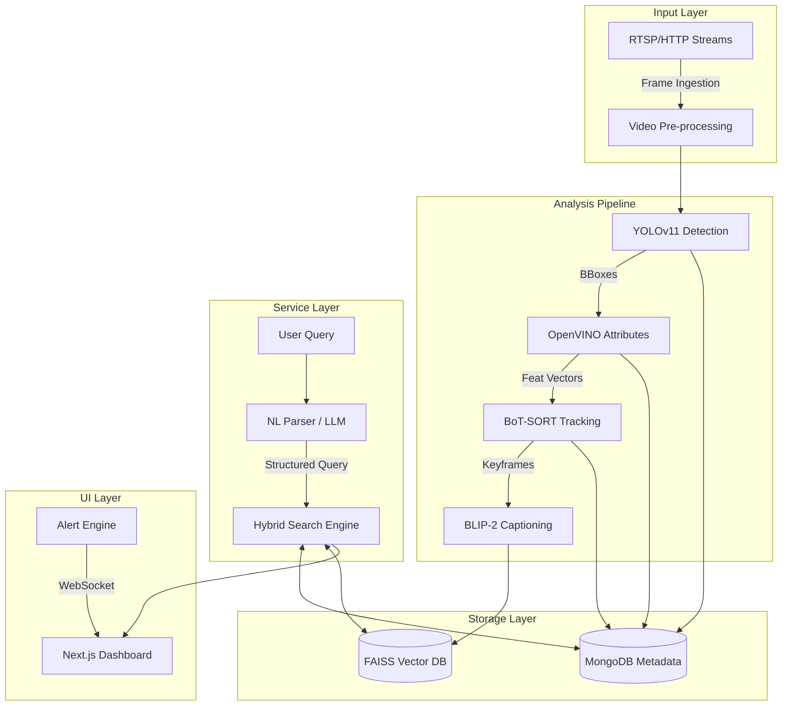

# AI-Powered Surveillance & Crowd Management with Natural Language Querying


## 📖 Overview

This project transforms passive CCTV video streams into a searchable, proactive intelligence asset. It integrates computer vision, deep learning, and Natural Language Processing (NLP) to enable real-time monitoring, crowd density estimation, and forensic video retrieval using conversational queries.

Unlike traditional systems that rely on manual timestamp scrubbing, this solution employs a **Retrieval-Augmented Generation (RAG)** pipeline. Users can query footage using natural language (e.g., *"Show me people wearing red jackets near the exit after 10 PM"*) to retrieve contextually relevant video clips.

---

## 🚀 Key Features


### Core Capabilities


*Figure 1: Real-time Monitoring Dashboard showing live camera feeds and system health.*

*   **Natural Language Video Retrieval**
    Utilizes a semantic search engine (LLM + Vector Search) to translate conversational queries into structured database filters and vector similarity searches.
    
    
    *Figure 2: Natural Language Query Interface for retrieving video footage.*

*   **Real-Time Analysis Pipeline**
    *   **Object Detection & Segmentation:** Powered by **YOLOv11-seg** for high-accuracy detection.
    *   **Person Attribute Recognition:** Uses **OpenVINO** to extract granular details (gender, clothing color, accessories).
    *   **Multi-Object Tracking:** Implements **BoT-SORT** with OSNet for persistent identity tracking across frames.

*   **Hybrid Search Engine**
    Combines structured metadata queries (MongoDB) with semantic vector embeddings (FAISS) for multimodal retrieval.

*   **Automated VLM Captioning**
    Generates descriptive textual summaries of video scenes using **BLIP-2** (Vision-Language Model) for deeper semantic understanding.

*   **Proactive Alerting**
    Configurable rule-based engine for detecting anomalies, intrusions, and crowd density violations in real-time.

    
    *Figure 3: Alerts Management Dashboard for configuring and monitoring system alerts.*

---

## 🏗️ System Architecture

The system operates on a microservices architecture comprising five core modules:

1.  **Input Layer:** Ingests RTSP/HTTP streams and local video files.
2.  **Analysis Pipeline:** Runs YOLOv11, OpenVINO, and BLIP-2 frame-by-frame.
3.  **Storage Layer:**
    *   **MongoDB:** Stores structured metadata (timestamps, class IDs, attributes).
    *   **FAISS:** Stores high-dimensional vector embeddings for semantic search.
4.  **Service Layer:** Handles NL parsing, hybrid search logic, and alert processing.
5.  **User Interface:** A Next.js dashboard for monitoring and querying.



---

## 🛠️ Tech Stack

*   **Frontend:** Next.js (React/TypeScript), Tailwind CSS.
*   **Backend:** Python, FastAPI.
*   **Computer Vision & AI:**
    *   PyTorch, OpenCV.
    *   Ultralytics YOLOv11m-seg.
    *   OpenVINO Toolkit.
    *   BoT-SORT & OSNet.
    *   BLIP-2 / ViT-GPT2.
*   **Database & Search:** MongoDB, FAISS (Facebook AI Similarity Search).
*   **LLM Integration:** local opencode runtime (default) or any
    OpenAI-compatible endpoint (OpenAI, OpenRouter, DeepSeek, vLLM,
    LM Studio, Ollama) for query translation.

---

## 📊 Performance

These are **full-deployment** figures from the paper's 4-camera, 312k-descriptor
run; they are not reproduced by the released single-camera subset.

*   **Detection Accuracy:** ~96.5% precision for Person class; ~91% for Gender recognition.
*   **Retrieval Latency:** ~109 ms for the FAISS retrieval step; end-to-end query
    latency is ~6 s mean / ~12 s for Find queries because parsing, blending, MMR,
    and clip stitching dominate. The 109 ms figure is not end-to-end latency.
*   **NL Parsing Accuracy:** 94% success rate in converting natural language to database filters.

### Released subset and reproducibility

The public artifact is intentionally smaller than the deployment: `camera_0`
only, 123 clips (640x480, 5 FPS, ~3.6 s each; ~7.2 min of selected footage
spanning a 2 h timestamp window), 242 scene frames, and 1,778 person
descriptors.  It is a code-path and reproducibility subset, not a reproduction
of the 4-camera/312k results.

**Which script produces which number.**  The paper quotes the *deployment*
measurements; the released track is a separate, self-contained check.

| Paper claim | Deployment number | Released-subset check | Script |
|---|---|---|---|
| C1 adaptive blending | 0.666 -> 0.828 macro P@5 | 0.538 (equals the best tune-selected fixed alpha; per-intent lookup 0.428) | `eval_retrieval_control.py` |
| C1 competitors / robustness | per-intent lookup 0.822, soft terms +0.006 | learned per-query alpha 0.534 (< 0.538); 16-point weight sweep all 0.538; count EM 0.10 / MAE 2.20 with the label-noise ceiling | `eval_alpha_competitors.py` |
| C2 person fusion | 0.807 concat vs 0.785 RRF vs 0.700 visual | code-path check on pseudo-tracks (no identity labels) — see `results/fusion_tables.md` | `eval_fusion.py` |
| C3 alert authoring | 0.91 rule-correctness (deployment study) | 30/30 clean and 30/30 stress on the author-constructed test split | `eval_alerts.py` |
| Latency | 6.0 s mean / 12.0 s Find (incl. parse and clip stitching) | scene core 37.4 ms p50 / 39.7 ms p95, person core 18.5 / 20.4 ms, 26.5-39.5 q/s at 1-8 workers | `measure_latency.py` |
| NL parse quality | 0.94 field-correctness (deployment) | per-field agreement of the production parser with the metadata-derived reference parse — agreement, not accuracy | `eval_parser.py` |
| End-to-end query path | not a paper claim; the paper reports no end-to-end subset number | NL query parsed by the deployed LLM backend, structured and semantic branches merged by the production adaptive-alpha rule | `eval_end_to_end.py` |

Run the offline checks without MongoDB:

```powershell
$env:PYTHONIOENCODING='utf-8'
python backend/scripts/check_release.py
python backend/scripts/eval_alerts.py
python backend/scripts/eval_retrieval_control.py   # <- the C1 number quoted in the paper
python backend/scripts/eval_alpha_competitors.py
python backend/scripts/eval_fusion.py
python backend/scripts/measure_latency.py
python backend/scripts/eval_parser.py               # <- parser quality, see below
python backend/scripts/eval_end_to_end.py           # <- real LLM parse, see below
python backend/scripts/eval_retrieval.py            # raw smoke test, see the note below
```

`eval_retrieval.py` is the *raw* released benchmark.  It is a code-path smoke
test, not the benchmark quoted in the paper: its count questions carry no
target count and its action queries carry explicit time windows, so it is not
protocol-matched to the deployment study.  The script prints this note itself;
use `eval_retrieval_control.py` for the number that appears in the paper.

### NL parser: local opencode runtime by default

The natural-language parser no longer depends on a hosted OpenAI key.  The
default provider is **`opencode`**, which drives the local opencode runtime
(https://opencode.ai).  The default model is **`opencode-go/beam-free`** (Beam
Free) and the configured fallback is `opencode-go/minimax-m3.1-flash-free`;
further models can be appended to the fallback chain.  The hosted
`gpt-4o-mini` path still works by setting `LLM_PROVIDER=openai` (its model
then defaults to `gpt-4o-mini`).

The free model choice is deliberate: the free tier of
`opencode/deepseek-v4.1-flash-free` is quota-limited, so a parse run can stop
with a provider usage-limit error.  `opencode-go/beam-free` and
`opencode-go/minimax-m3.1-flash-free` are not quota-limited;
`opencode-go/deepseek-v4.1-flash` works but is a paid tier, so it has to be
added explicitly.

| Variable | Default (`backend/app/config.py`) | Meaning |
|---|---|---|
| `LLM_PROVIDER` | `opencode` | `opencode`, `openai`, `openai_compatible` (alias `openai_compat`), `openrouter`, `ollama` |
| `NL_DEFAULT_MODEL` | `opencode-go/beam-free` | generic model id passed to the backend |
| `OPENCODE_MODEL` | `opencode-go/beam-free` | model used by the `opencode` provider |
| `OPENCODE_BASE_URL` | `http://127.0.0.1:4096` | opencode server URL; used by the `http` and `session` transports and passed to the CLI as `--server` only when it was set explicitly in the environment |
| `OPENCODE_MODEL_FALLBACKS` | `opencode-go/minimax-m3.1-flash-free` | comma-separated models tried in order when a model is unavailable |
| `OPENCODE_TRANSPORT` | `auto` | transport order for the opencode provider: `auto` expands to `http` -> `session` -> `cli` |
| `OPENCODE_TRANSPORT_RETRY_SECONDS` | `120` | how long a transport that answered "route not available" is skipped |
| `OPENCODE_CLI` | *(empty)* | path to the `opencode` executable; auto-detected when empty |
| `OPENCODE_CLI_USE_SERVER` | `false` | always pass `--server` to the CLI, even when the URL is only the default |
| `OPENCODE_SERVER_PASSWORD` | *(empty)* | bearer token for a password-protected opencode server |
| `OPENAI_BASE_URL` | *(empty)* | base URL of the OpenAI-compatible transport (OpenAI, OpenRouter, DeepSeek, Ollama `/v1`, vLLM, LM Studio) |
| `OPENROUTER_BASE_URL` | `https://openrouter.ai/api/v1` | base URL used when the provider is `openrouter` |
| `OLLAMA_BASE_URL` | `http://localhost:11434` | base URL used when the provider is `ollama` (`/v1` is appended) |
| `NL_TIMEOUT_SECONDS` | `300` | **total** budget of one parse: it bounds all transports and all fallback models together, so a request can never block for models x transports x timeout |
| `LLM_TIMEOUT` | `NL_TIMEOUT_SECONDS` | overrides `NL_TIMEOUT_SECONDS` for every transport |
| `NL_MAX_TOKENS` | `1400` | maximum reply length requested from the model |
| `DATA_EPOCH_DATE` | `2026-03-01` | date used to ground relative expressions ("today", "yesterday") |

Each provider has its own default model, so a leftover `NL_DEFAULT_MODEL`
cannot send an opencode model id to the hosted API: `openai` ->
`gpt-4o-mini` (`NL_OPENAI_MODEL`), `openrouter` -> `openai/gpt-4o-mini`
(`NL_OPENROUTER_MODEL`), `ollama` -> `llama3.1` (`NL_OLLAMA_MODEL`).  Values
set in `backend/.env` override these defaults.

`backend/app/services/llm_client.py` implements the transports and the
decoding:

*   `OpenAICompatBackend` — a plain `POST {base_url}/chat/completions`, so any
    server that speaks the OpenAI chat-completions contract works.
*   `OpencodeBackend` — drives the local opencode runtime over three
    transports, tried in order: `http` (an OpenAI-compatible route on the
    runtime), `session` (the opencode session API) and `cli`
    (`opencode run --server ... -m ... --format json`).  A transport that the
    runtime does not expose is remembered as unavailable and the next one is
    used.  On the CLI path the parser prompt (instructions + JSON schema +
    query) is longer than the Windows command-line limit, so it is written to
    a temporary `.md` file and attached with `opencode run --file <path>`; the
    reply is read from the NDJSON event stream that `--format json` emits.
*   `extract_json_object()` — tolerant JSON decoding: markdown fences, prose
    around the object, stray backslash escapes and unquoted keys are all
    tolerated.
*   `render_prompt()` — substitutes `{query}`, `{schema}`,
    `{format_instructions}` and `{reference_date}` in a single pass and leaves
    unknown placeholders untouched.  The parser requires all four
    placeholders and refuses to send a prompt with a leftover one, so
    relative dates resolve against the archive epoch (`DATA_EPOCH_DATE`)
    instead of the session date.

Small models answer with the right content but a slightly different *shape*
(`time.start` instead of `time.from_iso`, `count_constraint` as a bare
integer, `objects` as plain strings).  `nl_parser.coerce_to_nlfilter`
normalises that shape before the Pydantic validation, so a reply with the
right content is not thrown away because of its form.

```powershell
$env:PYTHONIOENCODING='utf-8'
python -c "from backend.app.services.nl_parser import parse_nl_with_llm; print(parse_nl_with_llm('show me a person wearing olive clothing between 17:01 and 17:03 on camera 0'))"
```

### End-to-end evaluation (real LLM parse)

`backend/scripts/eval_end_to_end.py` runs the complete query path on the
released subset: the natural-language query is parsed by the **deployed** LLM
backend (the same `nl_parser`/`llm_client` code the API uses), the parsed
filter drives the structured branch (colour, zone, action, count constraint
and the time window when the parser produced one), the semantic branch
searches the released OpenCLIP/FAISS scene index, and the production
adaptive-alpha rule (`result_merger.compute_adaptive_alpha`) merges the two
branches.

*   **Queries and split:** the default query file is
    `backend/benchmarks/queries_control.jsonl`, the protocol-matched control
    of `eval_retrieval_control.py` (same 150 queries, same 50 tune / 100 test
    split, same relevance labels, same per-category wording), so the two
    numbers differ only in where the filter comes from.  The raw released
    benchmark (`queries.jsonl`) can be run with `--queries`, but its numbers
    are not protocol-matched with the control track.
*   **Reported:** test macro P@5 and per-category P@5 for the five fixed
    alphas, `adaptive`, `per_intent_tuned` and `paper_lookup`, plus count
    EM/MAE, the per-category paired bootstrap with Holm correction and the
    grouped bootstrap of `adaptive` against the tune-selected best fixed
    alpha.
*   **Parse cache:** the parses are cached in
    `backend/benchmarks/parsed_cache/<model>.json` and written after every
    query, so an interrupted run resumes where it stopped and a re-run
    reproduces the same filters without calling the model.  `--refresh`
    ignores the cache.
*   **Outputs:** `results/end_to_end_results.json` and
    `results/end_to_end_tables.md` (`--out-prefix` changes the file names).
*   **Failure handling:** a query the model cannot answer is scored with a
    deterministic heuristic filter and flagged with `parse_ok: false`; a
    provider usage-limit error stops the run cleanly (exit code 2) after the
    cache has been saved.

```powershell
$env:PYTHONIOENCODING='utf-8'
python backend/scripts/eval_end_to_end.py                                     # default model, cached parses
python backend/scripts/eval_end_to_end.py --refresh                           # ignore the cache and re-parse
```

The opencode provider parses with `OPENCODE_MODEL`; set that variable (or
`backend/.env`) to parse with another model.  `--model` overrides the model id
that is reported and the cache file that is used.

This track is released-subset evidence for the deployed query path.  It is
single-camera (123 clips, `camera_0`, 242 scene frames, 1,778 person
descriptors) and does **not** reproduce the 4-camera / 312k-descriptor
deployment numbers quoted in the paper.

### Parser quality

`backend/scripts/eval_parser.py` measures the parser itself: every query of
the released benchmark is parsed through the production path
(`nl_parser.parse_nl_with_llm`) and the resulting filter is compared field by
field with the reference parse stored next to the query.  The reported numbers
are **agreement rates, not accuracy** — the reference is reconstructed from
the archive metadata, not annotated by a human, so a disagreement can be a
wrong reference rather than a wrong parse.  The script reports the per-field
agreement (overall and per category), the time-window error, the camera-id and
intent agreement on the queries that state them, the parse latency and the
queries with at least one disagreement.  Outputs:
`results/parser_results.json` and `results/parser_results.md`; the parses are
cached under `backend/benchmarks/parser_cache/`.

```powershell
$env:PYTHONIOENCODING='utf-8'
python backend/scripts/eval_parser.py --limit 150
python backend/scripts/eval_parser.py --refresh
```

See `results/README.md` for the two-track provenance policy and
`VERIFICATION.md` for the release checklist.

Build the supplementary archive (code, benchmarks, results, paper source;
superseded drafts and weights excluded by construction):

```powershell
python backend/scripts/package_release.py            # 1.3 MB
python backend/scripts/package_release.py --with-data # 18 MB, + clips and FAISS indices
```

---

## 🔮 Future Roadmap

*   **Multi-Camera Re-Identification:** Cross-camera tracking for continuous monitoring.
*   **Edge Deployment:** Optimization for low-power edge devices.
*   **Predictive Analytics:** Temporal models to predict crowd risks.

---

## Getting Started

Follow these instructions to set up the project locally for development.

### Prerequisites

*   Python 3.10+
*   Node.js 18+
*   MongoDB Instance
*   CUDA-compatible GPU (Recommended for inference acceleration)

### Backend Setup

1.  **Navigate to the backend directory:**
    ```bash
    cd backend
    ```

2.  **Create and activate a virtual environment:**
    ```bash
    python -m venv venv
    source venv/bin/activate  # On Windows: venv\Scripts\activate
    ```

3.  **Install dependencies:**
    ```bash
    pip install -r requirements.txt
    ```

4.  **Configure environment:**
    Create a `.env` file in the `backend` directory. Here is a template with standard defaults:

    ```ini
    # App Settings
    APP_NAME="AI-Powered-Surveillance-System-with-Natural-Language-based-Querying"
    DEBUG=true
    ALLOWED_ORIGINS="http://localhost:3000"

    # Database
    MONGODB_URI="mongodb://localhost:27017"
    MONGO_DB_NAME="ai_surveillance"

    # AI & ML Models
    MODEL_PATH="yolo11m-seg.pt"
    # LLM Provider (default: the local opencode runtime, no hosted key needed)
    LLM_PROVIDER="opencode"
    NL_DEFAULT_MODEL="opencode-go/beam-free"
    OPENCODE_BASE_URL="http://127.0.0.1:4096"
    # Optional: a hosted OpenAI-compatible endpoint instead
    # LLM_PROVIDER="openai_compatible"
    # OPENAI_BASE_URL="https://api.openai.com/v1"
    # OPENAI_API_KEY="sk-..."
    # If using Ollama locally
    # OLLAMA_BASE_URL="http://localhost:11434"

    # Semantic Search & Vector Store
    ENABLE_SEMANTIC=true
    EMBED_DEVICE="cuda" # Use 'cpu' if no GPU available
    HF_TOKEN="hf_..."
    ```

5.  **Start the server:**
    ```bash
    uvicorn main:app --reload
    ```

### Frontend Setup

1.  **Navigate to the frontend directory:**
    ```bash
    cd frontend
    ```

2.  **Install dependencies:**
    ```bash
    npm install
    ```

3.  **Start the development server:**
    ```bash
    npm run dev
    ```

4.  **Access the application:**
    Open your browser and navigate to `http://localhost:3000`.

---

## System Requirements

| Component | Minimum Specification | Recommended Specification |
|:---|:---|:---|
| **CPU** | 4 Cores | 8+ Cores |
| **RAM** | 16 GB | 32 GB+ |
| **GPU** | NVIDIA GTX 1060 (6GB) | NVIDIA RTX 3060 (12GB) or higher |
| **Storage** | 50 GB SSD | 500 GB NVMe SSD |
