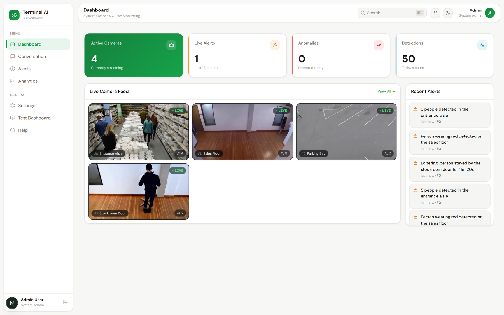
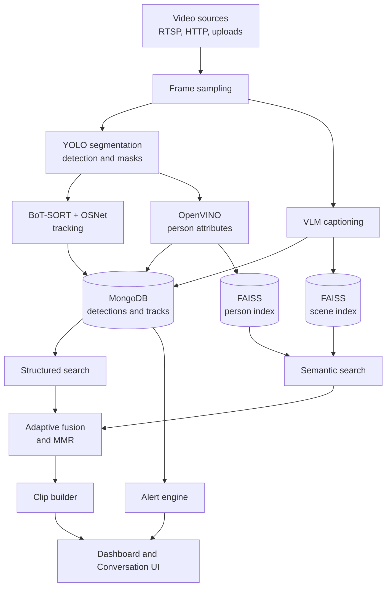
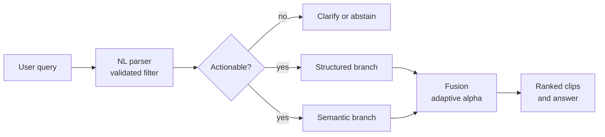
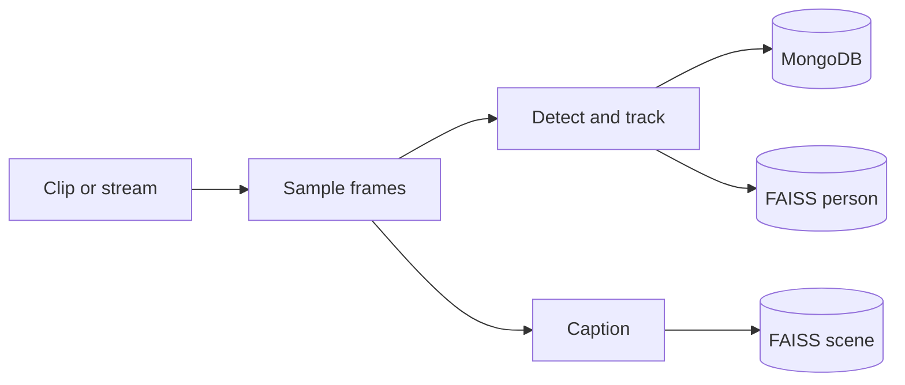
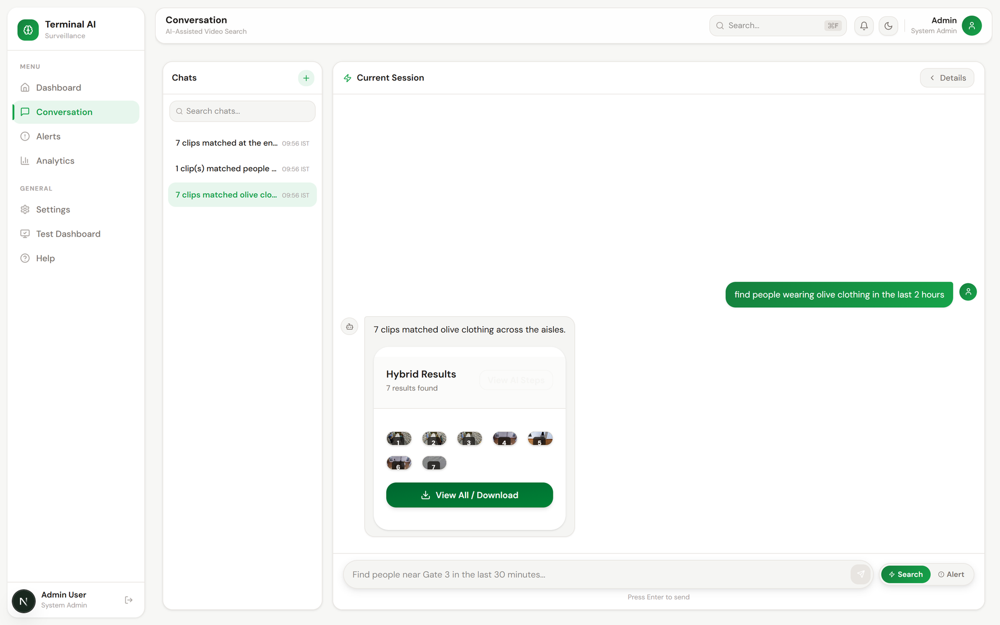
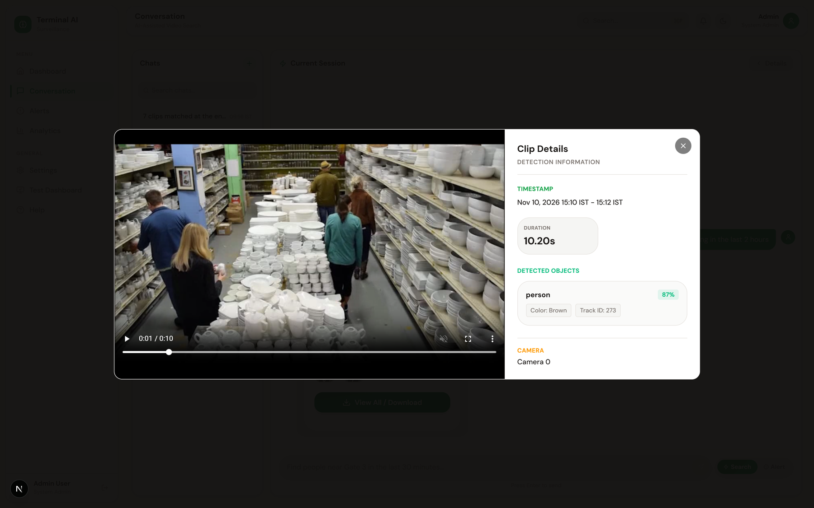
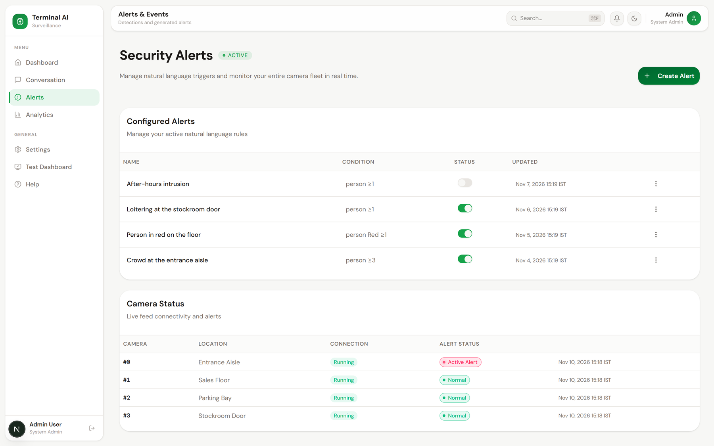
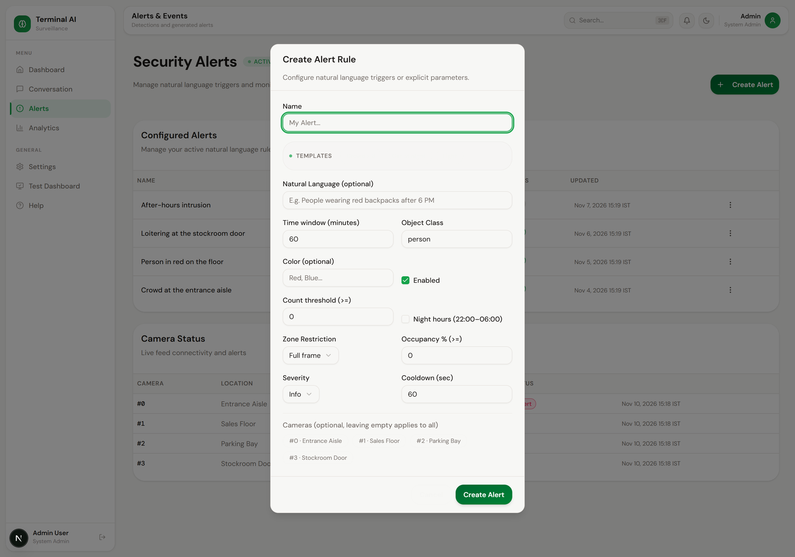

# AI-Powered Surveillance & Crowd Management with Natural Language Querying


Turn passive CCTV footage into a searchable intelligence asset. Ask in plain
language — *"show people in red near the entrance after 6 PM"*, *"how many people
were at the entrance today"* — and get ranked clips, counts and live alert rules.

Retrieval is hybrid: a **structured branch** over MongoDB detection metadata, a
**semantic branch** over FAISS scene/person embeddings, and an **intent-adaptive
fusion** rule that blends them per query.



---

## Features

- **Conversational retrieval** — free text becomes a validated filter (time, camera, zone, colour, count, action) executed across both branches.
- **Hybrid ranking** — per-branch normalisation, adaptive alpha, recency and MMR diversity.
- **Person search** — SigLIP + MiniLM descriptors fuse appearance with attribute text.
- **Alert authoring** — the same parser compiles sentences into executable, schema-validated rules.
- **Proactive monitoring** — rule evaluation, anomaly detection, clip/snapshot capture, websocket push.
- **Privacy controls** — attribute redaction as a deployment switch.

---

## Architecture



### Query path



### Indexing path



---

## Screens

**Conversational search** — a sentence in, ranked clips out.



**Clip detail** — the matched clip with its detection evidence.



**Alerts** — natural-language rules with per-camera status.





---

## Tech stack

- **Frontend:** Next.js, React, TypeScript, Tailwind CSS
- **Backend:** Python, FastAPI
- **Vision:** PyTorch, OpenCV, Ultralytics YOLO, OpenVINO, BoT-SORT + OSNet, SigLIP, CLIP, VLM captioning
- **Storage:** MongoDB (metadata), FAISS (vectors)
- **LLM:** any OpenAI-compatible chat-completions endpoint (local runtime, OpenAI, OpenRouter, vLLM, LM Studio, Ollama). Provider, base URL, model and API key are set through `.env`.

---

## Configuration

Copy `backend/.env.example` if present, otherwise create `backend/.env`:

```ini
APP_NAME="AI-Powered-Surveillance-System-with-Natural-Language-based-Querying"
DEBUG=true
ALLOWED_ORIGINS="http://localhost:3000"

MONGODB_URI="mongodb://localhost:27017"
MONGO_DB_NAME="ai_surveillance"

MODEL_PATH="yolo11m-seg.pt"
EMBED_DEVICE="cuda"          # use "cpu" without a GPU
ENABLE_SEMANTIC=true

# LLM: any OpenAI-compatible endpoint
LLM_PROVIDER="openai_compatible"
OPENAI_BASE_URL="http://localhost:11434/v1"
OPENAI_API_KEY=""
NL_DEFAULT_MODEL="llama3.1"
```

Set `LLM_PROVIDER` to the endpoint you run; `OPENAI_BASE_URL`, `OPENAI_API_KEY`
and `NL_DEFAULT_MODEL` describe it. The parser degrades to a regex fallback when
the endpoint is unreachable, so the UI stays usable offline.

---

## Getting started

**Prerequisites:** Python 3.10+, Node.js 18+, MongoDB, a CUDA GPU is recommended.

```bash
# backend
cd backend
python -m venv venv
source venv/bin/activate        # Windows: venv\Scripts\activate
pip install -r requirements.txt
uvicorn main:app --reload

# frontend
cd frontend
npm install
npm run dev
```

Open `http://localhost:3000`.

**Tests:**

```bash
python -m pytest backend/tests -q
```

---

## Evaluation

Offline checks run without MongoDB and write to `results/`:

```bash
python backend/scripts/check_release.py
python backend/scripts/eval_alerts.py
python backend/scripts/eval_retrieval_control.py
python backend/scripts/eval_fusion.py
python backend/scripts/eval_parser.py
python backend/scripts/measure_latency.py
```

The released subset is one camera: 123 clips, 242 scene frames and 1,778 person
descriptors. It exercises the code path; it does **not** reproduce multi-camera
deployment figures. `results/README.md` documents the provenance policy.

---

## System requirements

| Component | Minimum | Recommended |
|:---|:---|:---|
| CPU | 4 cores | 8+ cores |
| RAM | 16 GB | 32 GB+ |
| GPU | NVIDIA GTX 1060 (6 GB) | NVIDIA RTX 3060 (12 GB)+ |
| Storage | 50 GB SSD | 500 GB NVMe |
