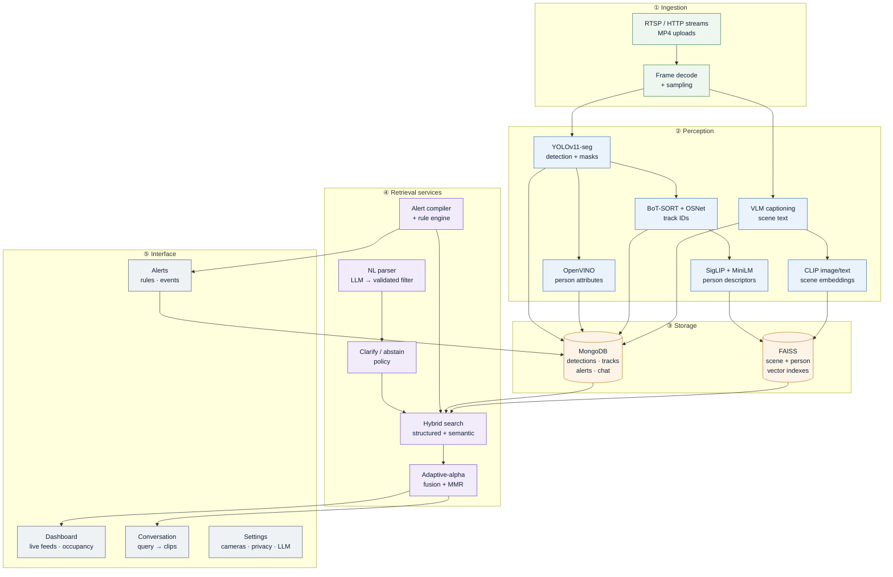
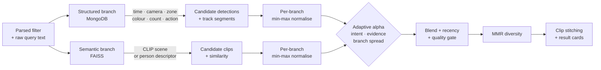
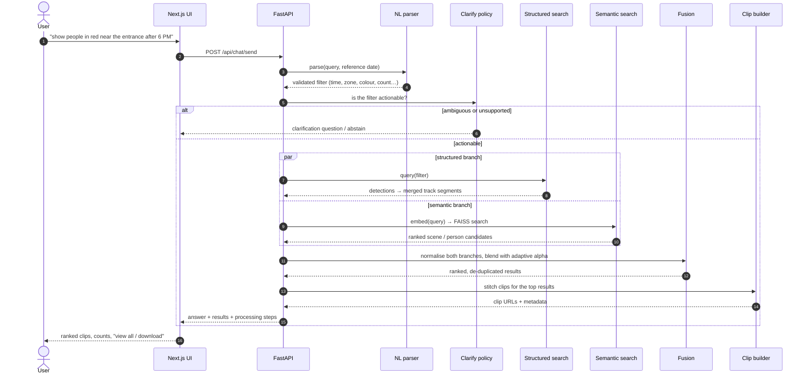
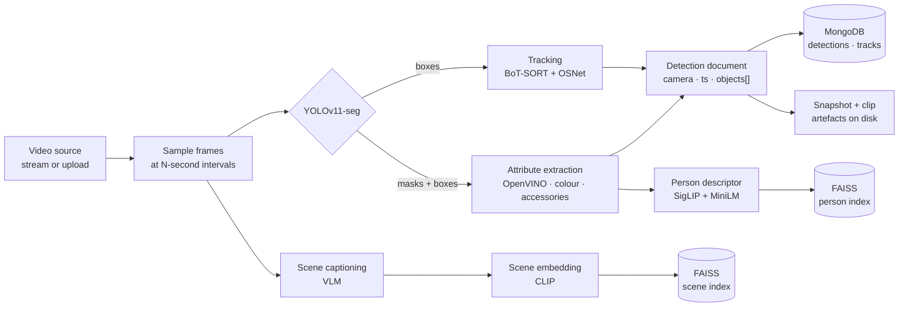
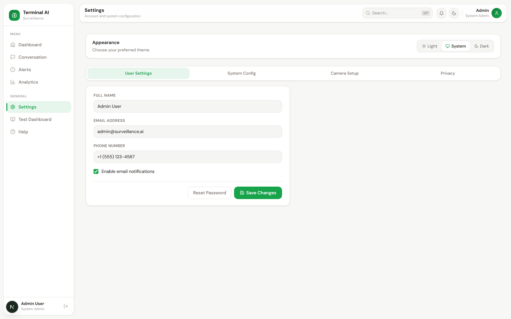

# AI-Powered Surveillance & Crowd Management with Natural Language Querying


**Terminal AI** turns passive CCTV footage into a searchable, proactive intelligence
asset. You talk to it in plain language — *"show people in red near the entrance
after 6 PM"*, *"how many people were at the entrance today"*, *"alert me when more
than six people queue at the checkout"* — and it answers with ranked clips, counts and
live rules.

Under the hood it is a hybrid retrieval system: a **deterministic structured branch**
over MongoDB detection metadata, a **semantic branch** over FAISS vector indexes, and
an **intent-adaptive fusion rule** that blends the two per query.


*Live multi-camera dashboard: streamed feeds, per-zone occupancy, anomaly badges and recent alerts.*

---

## Table of contents

- [What it does](#what-it-does)
- [Architecture](#architecture)
- [Query lifecycle](#query-lifecycle)
- [Ingestion pipeline](#ingestion-pipeline)
- [Screens](#screens)
- [Tech stack](#tech-stack)
- [Performance](#performance)
- [Released subset and reproducibility](#released-subset-and-reproducibility)
- [Getting started](#getting-started)
- [System requirements](#system-requirements)

---

## What it does

| Capability | What it means in practice |
|---|---|
| **Conversational retrieval** | Natural-language queries are compiled into a validated filter (time, camera, zone, colour, count, action) and executed across both retrieval branches. |
| **Hybrid ranking** | Structured metadata matches and CLIP semantic matches are normalised per branch and blended with an alpha that adapts to query intent and branch evidence. |
| **Person search** | A heterogeneous SigLIP + MiniLM person descriptor fuses appearance with attribute text (clothing colour, accessories) for person-centric queries. |
| **Alert authoring** | The same parser compiles sentences into executable alert rules — schema-validated, with clarify/abstain behaviour instead of silent guesses. |
| **Proactive monitoring** | Rule evaluation, anomaly detection (z-score against a historical baseline), clip/snapshot capture and websocket push. |
| **Privacy controls** | Attribute-level redaction (for example gender terms) is a deployment switch that also rebuilds stored attribute text. |

---

## Architecture

Five layers, cleanly separated: ingestion, perception, storage, retrieval services and
the UI. The perception layer only ever writes to the two stores; every read path goes
through the retrieval service, which is what keeps the structured and semantic branches
consistent with each other.



### Two stores, two branches



---

## Query lifecycle

Every query is parsed **once**, validated, and then both branches run on the same
filter. The parser is allowed to say *"I am not sure"* — clarification beats a
confident wrong filter.



---

## Ingestion pipeline



Streamed frames also feed an in-memory frame store, which is what the dashboard's
MJPEG tiles and the latest-frame endpoint read from.

---

## Screens

### Conversational search

Type a sentence, get ranked clips. Each result is a stitched clip with its own
metadata, and *View All / Download* exposes the full result set.


*Natural-language query with hybrid results and session history.*

Clicking a result opens the clip with its detection context — timestamp window,
duration, matched objects, colours, track ID and camera.


*Result detail: the stitched clip plus the detection evidence behind it.*

### Alerts

Rules are authored in natural language (or explicitly) and evaluated in real time
against the detection stream. The camera table shows connection and alert status per
camera.


*Alert rules, per-camera status and live events.*


*Creating a rule: NL trigger, time window, object class, colour, count threshold, zone, severity and cooldown.*

### Settings

Camera registration, indexing mode, LLM provider and privacy controls live here —
including attribute redaction that can rebuild the stored person index without the
redacted terms.


*Settings: appearance, system configuration, camera setup and privacy.*

---

## Tech stack

*   **Frontend:** Next.js (React/TypeScript), Tailwind CSS.
*   **Backend:** Python, FastAPI.
*   **Computer vision & AI:**
    *   PyTorch, OpenCV.
    *   Ultralytics YOLOv11m-seg.
    *   OpenVINO Toolkit (person attributes).
    *   BoT-SORT & OSNet (tracking / re-identification).
    *   SigLIP + MiniLM (person descriptors), CLIP (scene embeddings), BLIP-2 / ViT-GPT2 (captions).
*   **Database & search:** MongoDB (metadata), FAISS (vector indexes).
*   **LLM integration:** local opencode runtime (default) or any OpenAI-compatible
    endpoint (OpenAI, OpenRouter, DeepSeek, vLLM, LM Studio, Ollama) for query
    translation.

---

## Performance

These are **full-deployment** figures from a 4-camera, 312k-descriptor run; they are
not reproduced by the released single-camera subset.

*   **Detection accuracy:** ~96.5% precision for the person class; ~91% for gender recognition.
*   **Retrieval latency:** ~109 ms for the FAISS retrieval step. End-to-end query latency
    is ~6 s mean / ~12 s for find-type queries, because parsing, blending, MMR and clip
    stitching dominate. The 109 ms figure is *not* end-to-end latency.
*   **NL parsing:** 94% success rate converting natural language into database filters.

### Released subset and reproducibility

The public artifact is intentionally smaller than the deployment: `camera_0` only,
123 clips (640x480, 5 FPS, ~3.6 s each; ~7.2 min of selected footage spanning a 2 h
timestamp window), 242 scene frames and 1,778 person descriptors. It is a code-path and
reproducibility subset, not a reproduction of the 4-camera/312k results.

**Which script produces which number.** The deployment measurements and the released
track are separate, self-contained checks.

| Claim | Deployment number | Released-subset check | Script |
|---|---|---|---|
| C1 adaptive blending | 0.666 -> 0.828 macro P@5 | 0.538 (equals the best tune-selected fixed alpha; per-intent lookup 0.428) | `eval_retrieval_control.py` |
| C1 competitors / robustness | per-intent lookup 0.822, soft terms +0.006 | learned per-query alpha 0.534 (< 0.538); 16-point weight sweep all 0.538; count EM 0.10 / MAE 2.20 with the label-noise ceiling | `eval_alpha_competitors.py` |
| C2 person fusion | 0.807 concat vs 0.785 RRF vs 0.700 visual | code-path check on pseudo-tracks (no identity labels) — see `results/fusion_tables.md` | `eval_fusion.py` |
| C3 alert authoring | 0.91 rule-correctness (deployment study) | 30/30 clean and 30/30 stress on the author-constructed test split | `eval_alerts.py` |
| Latency | 6.0 s mean / 12.0 s find (incl. parse and clip stitching) | scene core 37.4 ms p50 / 39.7 ms p95, person core 18.5 / 20.4 ms, 26.5-39.5 q/s at 1-8 workers | `measure_latency.py` |
| NL parse quality | 0.94 field-correctness (deployment) | per-field agreement of the production parser with the metadata-derived reference parse — agreement, not accuracy | `eval_parser.py` |
| End-to-end query path | not a deployment claim | NL query parsed by the deployed LLM backend, branches merged by the production adaptive-alpha rule | `eval_end_to_end.py` |

Run the offline checks without MongoDB:

```powershell
$env:PYTHONIOENCODING='utf-8'
python backend/scripts/check_release.py
python backend/scripts/eval_alerts.py
python backend/scripts/eval_retrieval_control.py   # the C1 number quoted in the paper
python backend/scripts/eval_alpha_competitors.py
python backend/scripts/eval_fusion.py
python backend/scripts/measure_latency.py
python backend/scripts/eval_parser.py               # parser quality
python backend/scripts/eval_end_to_end.py           # real LLM parse
python backend/scripts/eval_retrieval.py            # raw smoke test
```

`eval_retrieval.py` is the *raw* released benchmark: a code-path smoke test, not the
protocol-matched benchmark. Its count questions carry no target count and its action
queries carry explicit time windows. Use `eval_retrieval_control.py` for the
protocol-matched number. The script prints this note itself.

### NL parser: local opencode runtime by default

The natural-language parser does not require a hosted OpenAI key. The default provider
is **`opencode`**, which drives the local opencode runtime (https://opencode.ai). The
default model is **`opencode-go/beam-free`** (Beam Free) and the configured fallback is
`opencode-go/minimax-m3.1-flash-free`; further models can be appended to the fallback
chain. The hosted `gpt-4o-mini` path still works with `LLM_PROVIDER=openai` (its model
then defaults to `gpt-4o-mini`).

The free model choice is deliberate: the free tier of
`opencode/deepseek-v4.1-flash-free` is quota-limited, so a parse run can stop with a
provider usage-limit error. `opencode-go/beam-free` and
`opencode-go/minimax-m3.1-flash-free` are not quota-limited;
`opencode-go/deepseek-v4.1-flash` works but is a paid tier, so it has to be added
explicitly.

| Variable | Default (`backend/app/config.py`) | Meaning |
|---|---|---|
| `LLM_PROVIDER` | `opencode` | `opencode`, `openai`, `openai_compatible` (alias `openai_compat`), `openrouter`, `ollama` |
| `NL_DEFAULT_MODEL` | `opencode-go/beam-free` | generic model id passed to the backend |
| `OPENCODE_MODEL` | `opencode-go/beam-free` | model used by the `opencode` provider |
| `OPENCODE_BASE_URL` | `http://127.0.0.1:4096` | opencode server URL; used by the `http` and `session` transports and passed to the CLI as `--server` only when set explicitly |
| `OPENCODE_MODEL_FALLBACKS` | `opencode-go/minimax-m3.1-flash-free` | comma-separated models tried in order when a model is unavailable |
| `OPENCODE_TRANSPORT` | `auto` | transport order: `auto` expands to `http` -> `session` -> `cli` |
| `OPENCODE_TRANSPORT_RETRY_SECONDS` | `120` | how long a transport that answered "route not available" is skipped |
| `OPENCODE_CLI` | *(empty)* | path to the `opencode` executable; auto-detected when empty |
| `OPENCODE_CLI_USE_SERVER` | `false` | always pass `--server` to the CLI, even when the URL is only the default |
| `OPENCODE_SERVER_PASSWORD` | *(empty)* | bearer token for a password-protected opencode server |
| `OPENAI_BASE_URL` | *(empty)* | base URL of the OpenAI-compatible transport (OpenAI, OpenRouter, DeepSeek, Ollama `/v1`, vLLM, LM Studio) |
| `OPENROUTER_BASE_URL` | `https://openrouter.ai/api/v1` | base URL used when the provider is `openrouter` |
| `OLLAMA_BASE_URL` | `http://localhost:11434` | base URL used when the provider is `ollama` (`/v1` is appended) |
| `NL_TIMEOUT_SECONDS` | `300` | **total** budget of one parse: it bounds all transports and all fallback models together |
| `LLM_TIMEOUT` | `NL_TIMEOUT_SECONDS` | overrides `NL_TIMEOUT_SECONDS` for every transport |
| `NL_MAX_TOKENS` | `1400` | maximum reply length requested from the model |
| `DATA_EPOCH_DATE` | `2026-03-01` | date used to ground relative expressions ("today", "yesterday") |

Each provider has its own default model, so a leftover `NL_DEFAULT_MODEL` cannot send
an opencode model id to the hosted API: `openai` -> `gpt-4o-mini` (`NL_OPENAI_MODEL`),
`openrouter` -> `openai/gpt-4o-mini` (`NL_OPENROUTER_MODEL`), `ollama` -> `llama3.1`
(`NL_OLLAMA_MODEL`). Values set in `backend/.env` override these defaults.

`backend/app/services/llm_client.py` implements the transports and the decoding:

*   `OpenAICompatBackend` — a plain `POST {base_url}/chat/completions`, so any server
    that speaks the OpenAI chat-completions contract works.
*   `OpencodeBackend` — drives the local opencode runtime over three transports, tried
    in order: `http` (an OpenAI-compatible route on the runtime), `session` (the
    opencode session API) and `cli` (`opencode run --server ... -m ... --format json`).
    A transport the runtime does not expose is remembered as unavailable and the next
    one is used. On the CLI path the parser prompt (instructions + JSON schema + query)
    is longer than the Windows command-line limit, so it is written to a temporary
    `.md` file and attached with `opencode run --file <path>`; the reply is read from
    the NDJSON event stream that `--format json` emits.
*   `extract_json_object()` — tolerant JSON decoding: markdown fences, prose around the
    object, stray backslash escapes and unquoted keys are all tolerated.
*   `render_prompt()` — substitutes `{query}`, `{schema}`, `{format_instructions}` and
    `{reference_date}` in a single pass and leaves unknown placeholders untouched. The
    parser requires all four placeholders and refuses to send a prompt with a leftover
    one, so relative dates resolve against the archive epoch (`DATA_EPOCH_DATE`)
    instead of the session date.

Small models answer with the right content but a slightly different *shape*
(`time.start` instead of `time.from_iso`, `count_constraint` as a bare integer,
`objects` as plain strings). `nl_parser.coerce_to_nlfilter` normalises that shape
before Pydantic validation, so a reply with the right content is not thrown away
because of its form.

```powershell
$env:PYTHONIOENCODING='utf-8'
python -c "from backend.app.services.nl_parser import parse_nl_with_llm; print(parse_nl_with_llm('show me a person wearing olive clothing between 17:01 and 17:03 on camera 0'))"
```

### End-to-end evaluation (real LLM parse)

`backend/scripts/eval_end_to_end.py` runs the complete query path on the released
subset: the query is parsed by the **deployed** LLM backend (the same
`nl_parser`/`llm_client` code the API uses), the parsed filter drives the structured
branch (colour, zone, action, count constraint and the time window when the parser
produced one), the semantic branch searches the released CLIP/FAISS scene index, and
the production adaptive-alpha rule (`result_merger.compute_adaptive_alpha`) merges the
two branches.

*   **Queries and split:** the default query file is
    `backend/benchmarks/queries_control.jsonl`, the protocol-matched control of
    `eval_retrieval_control.py` (same 150 queries, same 50 tune / 100 test split, same
    relevance labels, same per-category wording), so the two numbers differ only in
    where the filter comes from. The raw released benchmark (`queries.jsonl`) can be
    run with `--queries`, but its numbers are not protocol-matched.
*   **Reported:** test macro P@5 and per-category P@5 for the five fixed alphas,
    `adaptive`, `per_intent_tuned` and `paper_lookup`, plus count EM/MAE, the
    per-category paired bootstrap with Holm correction and the grouped bootstrap of
    `adaptive` against the tune-selected best fixed alpha.
*   **Parse cache:** parses are cached in `backend/benchmarks/parsed_cache/<model>.json`
    and written after every query, so an interrupted run resumes where it stopped and a
    re-run reproduces the same filters without calling the model. `--refresh` ignores
    the cache.
*   **Outputs:** `results/end_to_end_results.json` and `results/end_to_end_tables.md`
    (`--out-prefix` changes the file names).
*   **Failure handling:** a query the model cannot answer is scored with a
    deterministic heuristic filter and flagged `parse_ok: false`; a provider
    usage-limit error stops the run cleanly (exit code 2) after the cache is saved.

```powershell
$env:PYTHONIOENCODING='utf-8'
python backend/scripts/eval_end_to_end.py            # default model, cached parses
python backend/scripts/eval_end_to_end.py --refresh  # ignore the cache and re-parse
```

The opencode provider parses with `OPENCODE_MODEL`; set that variable (or
`backend/.env`) to parse with another model. `--model` overrides the model id that is
reported and the cache file that is used.

This track is released-subset evidence for the deployed query path. It is
single-camera (123 clips, `camera_0`, 242 scene frames, 1,778 person descriptors) and
does **not** reproduce the 4-camera / 312k-descriptor deployment numbers.

### Parser quality

`backend/scripts/eval_parser.py` measures the parser itself: every query of the
released benchmark is parsed through the production path
(`nl_parser.parse_nl_with_llm`) and the resulting filter is compared field by field
with the reference parse stored next to the query. The reported numbers are
**agreement rates, not accuracy** — the reference is reconstructed from the archive
metadata, not annotated by a human, so a disagreement can be a wrong reference rather
than a wrong parse. Outputs: `results/parser_results.json` and
`results/parser_results.md`; parses are cached under `backend/benchmarks/parser_cache/`.

```powershell
$env:PYTHONIOENCODING='utf-8'
python backend/scripts/eval_parser.py --limit 150
python backend/scripts/eval_parser.py --refresh
```

See `results/README.md` for the two-track provenance policy.

Build the supplementary archive (code, benchmarks, results; superseded drafts and
weights excluded by construction):

```powershell
python backend/scripts/package_release.py             # 1.3 MB
python backend/scripts/package_release.py --with-data # 18 MB, + clips and FAISS indices
```

---

## Roadmap

*   **Multi-camera re-identification:** cross-camera tracking for continuous monitoring.
*   **Edge deployment:** optimisation for low-power edge devices.
*   **Predictive analytics:** temporal models to predict crowd risk.

---

## Getting started

### Prerequisites

*   Python 3.10+
*   Node.js 18+
*   MongoDB instance (local or Atlas)
*   CUDA-compatible GPU (recommended for inference acceleration)

### Backend setup

1.  **Navigate to the backend directory:**
    ```bash
    cd backend
    ```

2.  **Create and activate a virtual environment:**
    ```bash
    python -m venv venv
    source venv/bin/activate  # On Windows: venv\Scripts\activate
    ```

3.  **Install dependencies:**
    ```bash
    pip install -r requirements.txt
    ```

4.  **Configure environment:** create a `.env` file in `backend`:

    ```ini
    # App settings
    APP_NAME="AI-Powered-Surveillance-System-with-Natural-Language-based-Querying"
    DEBUG=true
    ALLOWED_ORIGINS="http://localhost:3000"

    # Database
    MONGODB_URI="mongodb://localhost:27017"
    MONGO_DB_NAME="ai_surveillance"

    # Models
    MODEL_PATH="yolo11m-seg.pt"
    # LLM provider (default: local opencode runtime, no hosted key needed)
    LLM_PROVIDER="opencode"
    NL_DEFAULT_MODEL="opencode-go/beam-free"
    OPENCODE_BASE_URL="http://127.0.0.1:4096"
    # Optional: a hosted OpenAI-compatible endpoint instead
    # LLM_PROVIDER="openai_compatible"
    # OPENAI_BASE_URL="https://api.openai.com/v1"
    # OPENAI_API_KEY="sk-..."
    # If using Ollama locally
    # OLLAMA_BASE_URL="http://localhost:11434"

    # Semantic search & vector store
    ENABLE_SEMANTIC=true
    EMBED_DEVICE="cuda"  # use 'cpu' if no GPU is available
    HF_TOKEN="hf_..."
    ```

5.  **Start the server:**
    ```bash
    uvicorn main:app --reload
    ```

### Frontend setup

1.  **Navigate to the frontend directory:**
    ```bash
    cd frontend
    ```

2.  **Install dependencies:**
    ```bash
    npm install
    ```

3.  **Start the development server:**
    ```bash
    npm run dev
    ```

4.  **Open** `http://localhost:3000`.

### Tests

```powershell
python -m pytest backend/tests -q
```

---

## System requirements

| Component | Minimum | Recommended |
|:---|:---|:---|
| **CPU** | 4 cores | 8+ cores |
| **RAM** | 16 GB | 32 GB+ |
| **GPU** | NVIDIA GTX 1060 (6 GB) | NVIDIA RTX 3060 (12 GB) or higher |
| **Storage** | 50 GB SSD | 500 GB NVMe SSD |
